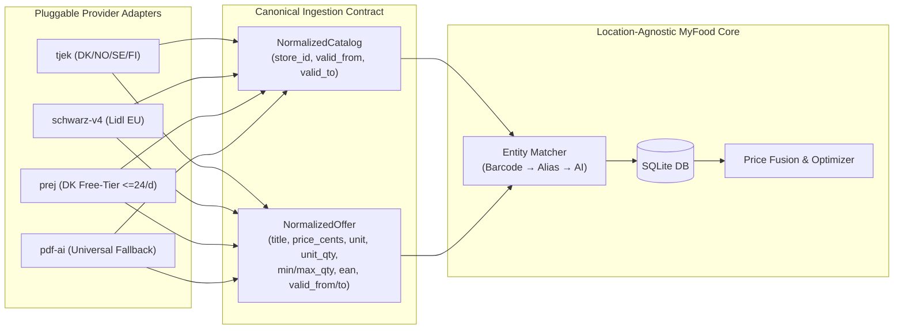
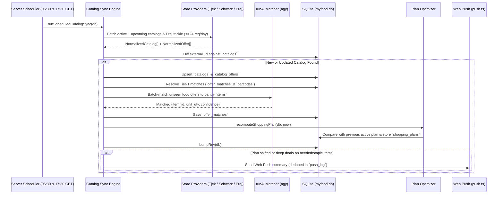

# Smart Groceries: Catalog Scraping, Price Fusion, Stock-Up Math & Plan Automation

Status: Approved Plan — 2026-11-18.

---

## Part 1: High-Level Investigation & Domain Design

### 1. Scraping Netto, Lidl & Coop 365 (Current + Next Week) & Modular Provider Design

#### 1.1 The Danish Catalog Release & Validity Calendar (Why "Current + Next Week" Works)
In Denmark, the three target discount chains run on **staggered weekly validity cycles** and publish their upcoming digital leaflets (*tilbudsaviser*) **1 to 4 days before they take effect**:

| Store Chain | Parent Group | Weekly Validity Period | When **Next Week's** Catalog Drops Online | Special Cadence Notes |
| :--- | :--- | :--- | :--- | :--- |
| **Netto** | Salling Group | **Saturday → Friday** (7d) | **Thursday – Friday** (~1–2 days early) | App-only *"Kun med Netto+"* deals exist alongside the main flyer. |
| **Lidl Danmark** | Schwarz Group | **Sunday → Saturday** (main food) & **Thursday → Saturday/Wednesday** (*spotvarer* / mid-week) | **Tuesday/Wednesday** (for Thu drops) & **Thursday/Friday** (for Sun drops) | Split two-wave cadence every week. |
| **Coop 365discount** | Coop Danmark | **Thursday → Wednesday** (7d) | **Monday – Tuesday** (sometimes Sat/Sun, ~2–4 days early) | Published as *365avisen* for current and upcoming week. |

Because validity windows are staggered (**Thu–Wed**, **Sat–Fri**, **Sun–Sat**) and next-week catalogs appear **1–4 days early**, there is almost always a multi-day lookahead window. Knowing Thursday on a Tuesday (Coop 365) or Saturday on a Thursday (Netto) lets the planner say: *"Don't buy butter today at 22 kr — wait 48 hours for Netto's Saturday catalog at 12 kr"* or *"Buy Skyr at Coop 365 before Wednesday when the 15 kr promo ends."*

#### 1.2 Concrete Data Sources for Copenhagen, Denmark

1. **Tjek / eTilbudsavis (`https://squid-api.tjek.com/v2`) — Primary Unified Nordic Provider**
   - **Coverage**: Indexes **Netto**, **Lidl**, and **365discount** under one normalized JSON schema for both **active** and **upcoming (next-week)** catalogs.
   - **Key Endpoints**:
     - `GET /v2/dealers` (or country filter `country_id=DK`): Dynamically resolves `dealer_id` hashes for slugs `netto`, `lidl`, and `365discount`.
     - `GET /v2/catalogs?dealer_ids={ids}&r_lat=55.6761&r_lng=12.5683&r_radius=5000`: Returns active and pre-released upcoming flyers localized to Copenhagen (`issue_date`, `run_from`, `run_till`, `publication_type: "paged" | "incito"`).
     - `GET /v2/offers?catalog_ids={id}` (or `/v2/offers?dealer_ids={ids}&r_lat=...`): Returns structured offer objects containing:
       - `heading`, `description`
       - `pricing: { price, pre_price, currency: "DKK" }`
       - `quantity: { unit: { symbol, si: { symbol, factor } }, size: { from, to }, pieces: { from, to } }`
       - `run_from`, `run_till` (ISO 8601 validity timestamps)
   - **Access model**: Community tools (`TilbudsTrolden-MCP`, `hacs-etilbudsavis`, `Kwtc.Tjek.Client`) query the consumer endpoints with standard `Origin` / `User-Agent` headers or anonymous session tokens (`POST /v2/sessions`); official partner keys use `X-ApiKey` + `X-Token`.

2. **Schwarz Group Leaflet API v4 (`https://endpoints.leaflets.schwarz/v4`) — Direct Lidl Provider (Pan-European)**
   - **Coverage**: Powers Lidl (and Kaufland) digital flyers across Europe (`lidl/da-DK`, `lidl/de-DE`, `lidl/it-IT`, `lidl/es-ES`, etc.).
   - **Access model**: Unauthenticated, public CDN-backed JSON REST API with `Access-Control-Allow-Origin: *`.
   - **Key Endpoints**:
     - `GET https://endpoints.leaflets.schwarz/v4/overview?client_locale=lidl/da-DK` → lists all `current` and `upcoming` flyers with `id`, `slug`, `startDate`, `endDate`, and direct `pdfUrl`.
     - `GET https://endpoints.leaflets.schwarz/v4/flyer?version=4&client=lidl&flyer_identifier={slug}&region_id=0&region_code=0` → returns per-page images, OCR `keyWords`, `altText`, product hotspots, and `pdfUrl`.

3. **Prej.dk API (`https://api.prej.app`) — Free-Tier Historical & Cross-Chain Enricher (Capped at <= 24 req/day)**
   - **Coverage**: Scrapes 20+ Danish chains nightly (including Netto shelf + promo catalog, Lidl, and 365discount) with prices in integer `øre` (`cents`) and ~91% GTIN/EAN barcode coverage.
   - **Key Endpoints**:
     - `GET /v1/offers` → active deals across chains, `multi_buy`, normal reference prices, discount %, and `offer_ends`.
     - `GET /v1/scan/{gtin}` → reverse-lookup unified Prej product ID and current cross-chain prices from a barcode.
     - `GET /v1/products/{id}/history` → 7-day price/discount history on the Free tier.
   - **Strict Free-Tier Quota Guard (`<= 24 calls/day`)**:
     - Free tier allows **25 requests/day** and **7 days of price history**.
     - We track daily usage in SQLite `meta` (`prej_quota_day = 'YYYY-MM-DD'`, `prej_quota_used = N`) with a hard ceiling of **24 calls/day** (1 call safety margin):
       - **1–3 calls/day** for bulk `/v1/offers` across `netto`, `lidl`, `365discount`.
       - **Up to 20 calls/day** trickle-backfilling `/v1/scan/{gtin}` and `/v1/products/{id}/history` for tracked pantry items (ordered by staleness `last_prej_sync_at ASC NULLS FIRST`). A 50-item pantry is completely backfilled within 3 days without ever touching paid quota.

4. **Coop 365 Direct (`365discount.coop.dk` / iPaper CDN) & Universal PDF/AI Fallback**
   - `365discount.coop.dk/tilbudsavis` publishes both current and next week's *365avisen* via iPaper (`cdn.ipaper.io/iPaper/Papers/{paperId}/Enrichments/v1/...`) and direct PDF downloads, while also syndicating structured offers to Tjek.

#### 1.3 Modular, Geo-Agnostic Provider Architecture
To guarantee that switching cities, countries, or supermarkets requires **zero changes to core business logic, database tables, or UI**, ingestion is separated into **Store Configurations** and **Provider Adapters**:



- **Why this is 100% portable**:
  - In **Copenhagen**, your active stores are configured as:
    - `netto-dk` → primary provider `tjek` (`dealer_slug: "netto"`), enriched by `prej`
    - `lidl-dk` → primary provider `tjek` (`dealer_slug: "lidl"`), fallback `schwarz-v4` (`locale: "lidl/da-DK"`), enriched by `prej`
    - `coop365-dk` → primary provider `tjek` (`dealer_slug: "365discount"`), fallback `pdf-ai`, enriched by `prej`
  - If you relocate to **Italy, Germany, or Spain**, you simply switch store configs in Settings (e.g. `lidl-it` uses `schwarz-v4` with `locale: "lidl/it-IT"`, and local chains use either a regional aggregator adapter or the universal `pdf-ai` adapter that extracts `NormalizedOffer[]` from any flyer URL/PDF via MyFood's existing `runAi` adapter).

---

### 2. Data Fusion: Catalog Offers + Last 3 Purchase Prices → Best Days & Stores

#### 2.1 Three-Tier Entity Resolution (Linking Offers to Pantry `items`)
A supermarket catalog lists ~150–300 offers in local language with brand and pack sizes (e.g. `"Lurpak Smør 200 g — 12 kr"`, `"Øko Letmælk 1 liter — 11 kr"`). Your pantry tracks canonical `items` (e.g. `Butter` in `g`, `Milk` in `ml`). We bridge them in three tiers:

1. **Tier 1 — Exact Barcode & Learned Offer Alias (Instant SQLite lookup, 0 AI cost)**:
   - If the offer carries an EAN/GTIN (e.g. from Prej), match against `barcodes.code -> item_id`.
   - Lookup `aliasKey(offer.title)` in a dedicated `offer_matches` cache table (`offer_key -> item_id, unit_qty, confidence`). Once `"lurpak smor 200g"` is mapped to `Butter (200g)` once, it resolves in `< 0.1 ms` forever.
2. **Tier 2 — Relevant Candidate Filtering**:
   - Skip obvious non-food/irrelevant categories (flowers, clothing, tools) so only food/household candidates proceed.
3. **Tier 3 — Batch AI Matcher (`runAi`) on Unseen Candidates**:
   - On new catalog ingestion, send a single compact batch prompt via `runAi` containing the user's non-archived pantry `items` (`id, name, category, unit, pack_size`) and the unmatched catalog offers (`offer_key, title, unit_raw, price_cents`).
   - The AI returns structured matches `{ offer_key, item_id, canonical_unit_qty, max_per_customer, confidence }`, which are persisted into `offer_matches`.

#### 2.2 Unit-Price Normalization & The "Last 3 Purchase Prices" Baseline
MyFood already normalizes item costs to **1 canonical `item.unit`** (`g`, `ml`, `pc`, `slice`, `portion`).
- For any catalog offer $o$ matched to item $i$ with canonical quantity $q_o$ (e.g. $q_o = 200\text{ g}$):
  $$u_{\text{offer}}(o) = \frac{o.\text{price\_cents}}{q_o} \quad (\text{cents per } 1\text{ item.unit})$$
- **Extracting the Last 3 Purchase Prices $[p_1, p_2, p_3]$**:
  - In MyFood, every purchase is an event (`events.kind = 'buy' AND events.undone_at IS NULL`) with lines in `event_lines`.
  - Using a window query over `event_lines JOIN events`, we take the **last 3 priced purchases** for each `item_id` ordered by `(e.at DESC, e.seq DESC)`:
    $$p_k = \frac{\text{line.cost\_cents}}{\text{line.qty}}, \quad k \in \{1, 2, 3\}$$
    *(falling back to `items.cost_per_unit_cents` or Prej's normal shelf price if an item has fewer than 3 historical buy events)*.
  - From $[p_1, p_2, p_3]$, we define the item's **Reference Baseline Price**:
    $$p_{\text{base}}(i) = \text{median}(p_1, p_2, p_3), \qquad p_{\text{min3}}(i) = \min(p_1, p_2, p_3)$$
  - Using the **median of the last 3 prices** instead of just the last 1 price prevents a single previous discount purchase (or a single emergency convenience-store purchase) from skewing what counts as a "good deal":
    $$\text{DiscountVsHistory}(o, i) = \frac{p_{\text{base}}(i) - u_{\text{offer}}(o)}{p_{\text{base}}(i)}$$

#### 2.3 Deciding the Best Days & Stores to Shop (Trip & Calendar Optimizer)
Given a planning horizon of $D = 10$ days (covering current week + next week's early-released catalogs):
1. **Need Urgency & Deadline Day ($d_{\text{deadline}}(i)$)**:
   - From `eat` events over the last 30 days (including `source = 'cook'` ingredient consumption) and active `presets`, compute each item's daily burn rate $r_i$ (units/day).
   - Given current stock $S_i = \text{shown}(\text{stock}_i)$ and threshold $L_i = \text{low\_at}_i ?? 0$:
     $$d_{\text{deadline}}(i) = \begin{cases} 0 & \text{if } S_i \le L_i \text{ (already low/out)} \\ \lfloor (S_i - L_i) / r_i \rfloor & \text{if } r_i > 0 \\ \infty & \text{otherwise} \end{cases}$$
2. **Date-Aware Store Offer Matrix**:
   - Because Netto starts Saturday, Lidl starts Sunday/Thursday, and Coop 365 starts Thursday, the set of active offers at store $s$ depends on the exact calendar date $d$:
     $$\text{BestUnitCost}(i, s, d) = \min \left\{ u_{\text{offer}}(o) \;\middle|\; o \in \text{Offers}(i, s),\; o.\text{valid\_from} \le d \le o.\text{valid\_to} \right\} \cup \{ p_{\text{base}}(i) \}$$
3. **Scoring Candidate Shopping Trips (1-Trip vs. 2-Trip Plans)**:
   - Visiting an extra store or making an extra trip has a real human friction cost $\lambda_{\text{trip}} = 2500\text{ øre}$ (**25 kr** extra savings threshold, max **2 stores/week** by default).
   - For any candidate schedule $\mathcal{T} = \{(d_1, s_1), (d_2, s_2)\}$ (where $|\mathcal{T}| \in \{1, 2\}$):
     $$\text{Score}(\mathcal{T}) = \sum_{i \in \text{Basket}} Q_i \cdot \max_{t \in \mathcal{T}}\!\left(p_{\text{base}}(i) - \text{BestUnitCost}(i, s_t, d_t)\right) - \lambda_{\text{trip}} \cdot (|\mathcal{T}| - 1) - \sum_{i \in \text{Basket}} \text{LatePenalty}(i, d_{t(i)}, d_{\text{deadline}}(i))$$
   - **What this produces**:
     - **Single Best Trip**: *"Go to **Coop 365 on Thursday** (covers 7 needed items, saves 64 kr vs your last-3 average)."*
     - **Split Trip (only recommended when extra savings beat 25 kr)**: *"Go to **Lidl today (Wed)** for urgent Milk & Chicken (saves 28 kr before promo ends tonight), and **wait until Saturday at Netto** to stock up on Butter, Oats & Coffee when next week's catalog starts (saves an extra 52 kr)."*

---

### 3. Deciding How Much to Buy Based on Discount Frequency

#### 3.1 Three-Layer Historical Frequency Engine (Local Archive + Prej Free-Tier Backfill + Purchase Ledger)
Because public flyer endpoints (`squid-api.tjek.com`, `endpoints.leaflets.schwarz`, `365discount.coop.dk`) unpublish expired catalogs once `valid_to < now`, MyFood combines three layers:

1. **Layer 1 — Local Permanent Catalog Archive (`catalog_offers`)**:
   - Every offer scraped by MyFood is stored permanently in SQLite with `(item_id, store_id, unit_cost_cents, valid_from, valid_to)`. Expired offers are **never deleted** (a 1-year archive of 3 stores is ~15,000 rows ≈ `< 4 MB` in SQLite).
2. **Layer 2 — Day-1 Warm Start (Prej.dk 7-Day Free-Tier History + MyFood `events` Ledger)**:
   - **Prej.dk Free-Tier Trickle (`<= 24 req/day`)**: Fetches 7-day price & promo history for tracked pantry items via `/v1/products/{id}/history` and `/v1/offers`, immediately populating recent campaign windows and normal shelf prices.
   - **MyFood Purchase Ledger (`events` + `event_lines`)**: Any historical `buy` event where `unit_cost_cents <= 0.85 * median_price` counts as an observed past discount date.
3. **Layer 3 — Empirical Bayes Inter-Discount Cadence ($\hat{T}_{\text{promo}}$)**:
   - Suppose item $i$ has $k$ observed discount campaigns across your enabled stores with start dates $t_1 < t_2 < \dots < t_k$, giving observed gaps $\Delta t_j = t_{j+1} - t_j$.
   - When $k$ is small (cold start), we blend observed intervals with a category prior $\mu_{\text{cat}}$ (`dairy/bakery/produce`: 14 days; `meat`: 18 days; `pantry/frozen/drinks`: 28 days) with prior weight $n_0 = 2$:
     $$\hat{T}_{\text{promo}}(i) = \frac{n_0 \cdot \mu_{\text{cat}}(i) + \sum_{j=1}^{k-1} \Delta t_j}{n_0 + \max(0, k - 1)}$$

#### 3.2 The Stock-Up Quantity Formula
When item $i$ is on sale at unit price $u_{\text{offer}}$ vs baseline $p_{\text{base}}$, how much should you buy?

1. **Discount Depth Multiplier ($m_{\text{depth}}$)**:
   - Define relative discount $\delta = \frac{p_{\text{base}} - u_{\text{offer}}}{p_{\text{base}}}$.
   - If $\delta < 0.10$ (weak deal, $<10\%$ off): don't stock up — only buy immediate need ($H_{\text{target}} = 7\text{ days}$).
   - If $\delta \ge 0.10$: scale the target bridge horizon up to the expected time until the *next* discount $\hat{T}_{\text{promo}}(i)$, with a bonus up to $1.35\times$ if $u_{\text{offer}} \le p_{\text{min3}}(i)$ (beats all 3 recent purchases):
     $$H_{\text{promo}}(i) = \hat{T}_{\text{promo}}(i) \cdot \text{clamp}\!\left(0.8 + 1.5\delta,\; 0.75,\; 1.35\right)$$
   - **Lookahead Override**: If an *upcoming* next-week catalog already has a *cheaper* offer starting in $d_{\text{next}}$ days, clamp $H_{\text{promo}}(i) = d_{\text{next}}$ (only buy enough to survive until the better deal starts!).
2. **Shelf-Life & Storage Cap ($H_{\text{cap}}$)**:
   - Using MyFood's existing `items.shelf_life_days` (`schema.sql:41`):
     $$H_{\text{effective}}(i) = \min\left(H_{\text{promo}}(i),\; \text{shelf\_life\_days}_i ?? 60,\; H_{\text{max\_storage}}\right)$$
3. **Pack Quantization & Store Cap (`max_per_customer`)**:
   - With daily consumption rate $r_i$ (units/day) and current stock $S_i$:
     $$U_{\text{needed}}(i) = \max\left(0,\; r_i \cdot H_{\text{effective}}(i) - S_i\right)$$
     $$Q_{\text{packs}}(i) = \text{clamp}\!\left(\left\lceil \frac{U_{\text{needed}}(i)}{q_o} \right\rceil,\; o.\text{min\_buy\_qty},\; o.\text{max\_per\_customer}\right)$$
   - Every recommendation includes an explainable rationale string:
     - e.g., *"Buy **3 packs (600 g)** · 12 kr/pk (33% below your last 3 buys: 18, 19, 17 kr) · Covers ~21 days until next expected promo."*

---

### 4. Automation When New Catalogs Drop



---

## Part 2: Architectural Integration into MyFood

Following the codebase's established philosophy in `docs/nutrition-spend-plan.md` (**"a feature is a folder slice per layer, registered by one function call; plain functions taking `(db, ...)`; shared pure maths tested without DB or DOM; keep `State` small"**):

### 1. Folder Slice Layout

```text
src/shared/
  deals.ts                  pure maths (0 DB/DOM deps):
                            - lastThreePrices(), baselinePrice()
                            - computeBurnRates() (from eat + cook events & presets)
                            - computeDiscountCadence() (Empirical Bayes intervals)
                            - recommendStockUpQty() (horizon, shelf_life_days, pack rounding)
                            - optimizeShoppingPlan() (1-trip vs 2-trip date/store scorer, 25 kr trip threshold)
src/server/
  deals/
    providers/
      types.ts              CatalogProvider interface, NormalizedCatalog, NormalizedOffer
      tjek.ts               Tjek / eTilbudsavis v2 adapter (Netto, Lidl, Coop 365, etc.)
      schwarz.ts            Schwarz Group v4 adapter (Lidl DK + any EU locale)
      prej.ts               Prej.dk Free-Tier adapter + strict 24 req/day quota guard
      pdf-ai.ts             Universal flyer URL/PDF -> runAi offer extractor fallback
      index.ts              Provider registry map: Record<ProviderId, CatalogProvider>
    matcher.ts              Tier-1 (barcode/offer_matches) + Tier-3 (runAi batch matcher)
    sync.ts                 syncAllStores(db, deps), diffing, plan recompute, push triggers
    repo.ts                 SQL queries for stores, catalogs, offers, matches, price history, plans
    routes.ts               registerDealsRoutes(app, deps): /api/deals/*
    mcp.ts                  registerDealsTools(server, deps): MCP tools for AI assistants
src/web/ui/
  deals/
    screen.ts               Smart Shopping / Deals view (page/sheet from Pantry & Spend)
    actions.ts              Action handlers (sync now, pin store/day, confirm/override match)
```

---

### 2. SQLite Schema Additions (`PRAGMA user_version = 5`)

Added via `src/server/schema.sql` and `src/server/db.ts` `migrate()`:

```sql
-- 1. Modular store configurations (switchable per city/country)
CREATE TABLE IF NOT EXISTS stores (
  id TEXT PRIMARY KEY,                  -- e.g. 'netto-dk', 'lidl-dk', 'coop365-dk'
  name TEXT NOT NULL,                   -- 'Netto', 'Lidl', 'Coop 365discount'
  emoji TEXT NOT NULL DEFAULT '🏪',
  chain TEXT NOT NULL,                  -- 'netto' | 'lidl' | '365discount'
  country TEXT NOT NULL DEFAULT 'DK',
  currency TEXT NOT NULL DEFAULT 'DKK',
  provider TEXT NOT NULL,               -- 'tjek' | 'schwarz' | 'prej' | 'pdf-ai'
  provider_config TEXT NOT NULL,        -- JSON: e.g. {"dealer_slug":"netto","lat":55.6761,"lng":12.5683,"radius":5000}
  enabled INTEGER NOT NULL DEFAULT 1,
  last_synced_at INTEGER
);

-- 2. Ingested weekly & next-week catalogs
CREATE TABLE IF NOT EXISTS catalogs (
  id INTEGER PRIMARY KEY,
  store_id TEXT NOT NULL REFERENCES stores(id) ON DELETE CASCADE,
  external_id TEXT NOT NULL,            -- provider's catalog ID / slug
  title TEXT NOT NULL,
  valid_from TEXT NOT NULL,             -- YYYY-MM-DD (Europe/Copenhagen)
  valid_to TEXT NOT NULL,               -- YYYY-MM-DD
  source_url TEXT,
  fetched_at INTEGER NOT NULL,
  UNIQUE (store_id, external_id)
);
CREATE INDEX IF NOT EXISTS catalogs_validity ON catalogs(valid_from, valid_to);

-- 3. Historical + active catalog offers (never deleted on expiry -> builds frequency archive)
CREATE TABLE IF NOT EXISTS catalog_offers (
  id INTEGER PRIMARY KEY,
  catalog_id INTEGER NOT NULL REFERENCES catalogs(id) ON DELETE CASCADE,
  store_id TEXT NOT NULL REFERENCES stores(id) ON DELETE CASCADE,
  external_id TEXT NOT NULL,
  title TEXT NOT NULL,
  offer_key TEXT NOT NULL,              -- normalized via aliasKey(title + unit_raw)
  description TEXT,
  price_cents INTEGER NOT NULL,         -- promo pack price in minor units (øre/cents)
  normal_price_cents INTEGER,           -- pre-discount price if provided by catalog/Prej
  unit TEXT,                            -- normalized 'g' | 'ml' | 'pc' | NULL
  unit_qty REAL,                        -- quantity per pack in `unit` (e.g. 200 for 200g)
  min_buy_qty INTEGER NOT NULL DEFAULT 1,
  max_per_customer INTEGER,             -- e.g. 3 for "Maks. 3 stk."
  ean TEXT,
  valid_from TEXT NOT NULL,             -- YYYY-MM-DD
  valid_to TEXT NOT NULL,               -- YYYY-MM-DD
  UNIQUE (catalog_id, external_id)
);
CREATE INDEX IF NOT EXISTS catalog_offers_key ON catalog_offers(offer_key);
CREATE INDEX IF NOT EXISTS catalog_offers_dates ON catalog_offers(valid_from, valid_to);

-- 4. Learned mapping between normalized catalog offer keys and pantry items
CREATE TABLE IF NOT EXISTS offer_matches (
  offer_key TEXT PRIMARY KEY,
  item_id INTEGER REFERENCES items(id) ON DELETE CASCADE, -- NULL = explicitly ignored (non-food/irrelevant)
  canonical_unit_qty REAL NOT NULL,     -- pack size expressed in items.unit
  confidence REAL NOT NULL DEFAULT 1.0,
  source TEXT NOT NULL,                 -- 'barcode' | 'alias' | 'ai' | 'manual'
  updated_at INTEGER NOT NULL
);
CREATE INDEX IF NOT EXISTS offer_matches_item ON offer_matches(item_id);

-- 5. Computed / cached shopping plan snapshots (for diffing when new catalogs arrive)
CREATE TABLE IF NOT EXISTS shopping_plans (
  id INTEGER PRIMARY KEY,
  generated_at INTEGER NOT NULL,
  horizon_from TEXT NOT NULL,           -- YYYY-MM-DD
  horizon_to TEXT NOT NULL,             -- YYYY-MM-DD
  plan_json TEXT NOT NULL               -- serialized ShoppingPlan (trips, items, quantities, savings)
);

-- 6. Column additions on existing tables
ALTER TABLE events ADD COLUMN store_id TEXT REFERENCES stores(id);
ALTER TABLE users  ADD COLUMN notify_deals INTEGER NOT NULL DEFAULT 1;
ALTER TABLE items  ADD COLUMN prej_product_id TEXT;
ALTER TABLE items  ADD COLUMN prej_synced_at INTEGER;
```

#### How the "Last 3 Purchase Prices" Works Without Data Drift
Instead of duplicating mutable price arrays on `items` that could get out of sync when an event is edited or undone, `src/server/deals/repo.ts` queries the authoritative event ledger directly with a window function:

```sql
WITH ranked_buys AS (
  SELECT
    l.item_id,
    e.at,
    e.store_id,
    e.note,
    CAST(l.cost_cents AS REAL) / l.qty AS unit_cost_cents,
    ROW_NUMBER() OVER (PARTITION BY l.item_id ORDER BY e.at DESC, e.seq DESC) AS rn
  FROM event_lines l
  JOIN events e ON e.cid = l.event_cid
  JOIN items i ON i.id = l.item_id
  WHERE e.kind = 'buy'
    AND e.undone_at IS NULL
    AND l.is_set = 0
    AND l.qty > 0
    AND l.cost_cents IS NOT NULL
    AND l.cost_cents > 0
    AND i.unit <> 'level'
)
SELECT item_id, at, store_id, note, unit_cost_cents
FROM ranked_buys
WHERE rn <= 3
ORDER BY item_id, rn;
```

---

### 3. Keeping `/api/state` Fast vs. On-Demand Deals Endpoints

- **`State` (`/api/state`) stays compact**:
  - Add only a lightweight summary badge to `State` (or `Item`): e.g. `active_deal?: { store_id: string; price_cents: number; unit_cost_cents: number; saving_pct: number; valid_from: string; valid_to: string }` on matched pantry items, plus `shopping_plan_summary?: { best_day: string; best_store_name: string; total_saving_cents: number; deal_count: number }`.
- **Dedicated `/api/deals/*` Routes (`src/server/deals/routes.ts`)**:
  - `GET /api/deals/plan` → returns the full `ShoppingPlan`:
    - Recommended trips (Day + Store, e.g. *"Thu 19 Nov · Coop 365"* + *"Sat 21 Nov · Netto"*),
    - Per-item breakdown: current stock, burn rate (`g/day`), days until low, last 3 prices paid `[p1, p2, p3]`, active/upcoming catalog price per store, discount frequency (`every ~16d`), recommended pack quantity $Q_{\text{packs}}$, and total kr saved.
  - `GET /api/deals/catalogs` → lists active and upcoming next-week catalogs per store with sync status and Prej daily quota counter (`used / 24`).
  - `POST /api/deals/sync` → triggers an immediate catalog sync + plan recomputation.
  - `PUT /api/deals/stores` → enable/disable stores, switch location coordinates (`lat`, `lng`, `radius`), or add a custom store/provider.
  - `POST /api/deals/match` → manually link/unlink a catalog `offer_key` to an `item_id` (override AI match).

---

### 4. UI & MCP Integration

#### 4.1 PWA UI Integration
1. **Pantry Screen (`src/web/ui/screens/pantry.ts`)**:
   - Upgrade the existing **"Running low"** card into a **"Smart Shopping Plan"** strip whenever low items or high-value stock-up deals exist:
     - Shows: *"🛒 Best trip: **Sat at Netto** (5 items · save 48 kr) · **Wait on Butter** (-35% from Sat)"*
     - Clicking opens the **Shopping Plan page/sheet** (`ui.page.push('deals')`).
2. **Item Sheet (`src/web/ui/components/sheets.ts`)**:
   - Under the item's price field, show the **Last 3 Prices chip row** (e.g. `Last 3: 18 kr · 15 kr · 19 kr`) and any active/upcoming catalog badge (`🏷️ Netto: 12 kr from Sat`).
3. **Receipt / Buy Logging (`src/web/ui/components/sheets.ts` & `src/server/jobs.ts`)**:
   - Add an optional store selector chip (`Netto`, `Lidl`, `Coop 365`, `Other`) on `buy` events and auto-detect the store name from receipt OCR in `src/server/ai/prompt.ts` so `events.store_id` is populated automatically when scanning receipts.
4. **Settings → Stores & Catalogs (`src/web/ui/settings/stores.ts`)**:
   - Configure location (currently `Copenhagen, DK · 55.6761, 12.5683`), toggle stores (`Netto`, `Lidl`, `Coop 365`), switch provider adapters, view Prej free-tier daily quota usage, and hit **"Sync catalogs now"**.

#### 4.2 New MCP Tools (`src/server/deals/mcp.ts`)
Registered via `registerDealsTools(server, deps)` in `src/server/mcp.ts`:
- `get_shopping_plan`: Returns the optimal shopping days, stores, itemized quantities to buy (with stock-up math and last-3 price comparison), and lookahead warnings ("wait until Saturday").
- `search_catalog_offers`: Search current + next week's scraped offers across Netto, Lidl, and Coop 365 (even for items not yet in the pantry, e.g. when planning a new meal).
- `sync_catalogs`: Force-poll store providers for new catalogs and recompute the plan.
- `link_catalog_offer`: Link or ignore a catalog offer to a pantry item.

---

### 5. Phased Implementation Roadmap

1. **Phase 1 — Store Registry & Modular Ingestion Engine (`tjek` + `schwarz-v4` + `prej` Free-Tier)**
   - Migration `user_version = 5` (`stores`, `catalogs`, `catalog_offers`, `offer_matches`, `shopping_plans`, `events.store_id`, `items.prej_product_id`, `items.prej_synced_at`).
   - Seed default Copenhagen stores (`netto-dk`, `lidl-dk`, `coop365-dk`).
   - Implement `CatalogProvider` interface + `tjek.ts` (primary unified DK feed for all 3 stores) + `schwarz.ts` (direct Lidl v4 API) + `prej.ts` (free-tier offers & 7-day history trickle capped strictly at `<= 24 req/day`).
   - Unit tests with recorded JSON fixtures from Tjek, Schwarz, and Prej APIs + quota-cap tests.
2. **Phase 2 — Last-3 Price History & 3-Tier Offer-to-Item Matcher**
   - Implement `lastThreePrices(db)` in `src/server/deals/repo.ts` + receipt store auto-detection in `src/server/ai/prompt.ts`.
   - Implement `matcher.ts` (Barcode → `offer_matches` alias key → `runAi` batch matcher for unseen food offers).
   - Expose last 3 prices and active deal badges in the Item Sheet.
3. **Phase 3 — Pure Optimization Engine (`src/shared/deals.ts`)**
   - Implement `computeBurnRates`, `computeDiscountCadence` (Empirical Bayes over `catalog_offers` + Prej 7d history + past `buy` events), `recommendStockUpQty` (bounded by `shelf_life_days` and `max_per_customer`), and `optimizeShoppingPlan` (1-trip vs 2-trip calendar solver with `25 kr` extra-trip threshold and max `2` stores/week).
   - Comprehensive pure-function tests in `tests/deals.test.ts`.
4. **Phase 4 — Scheduled Automation, Web Push & UI / MCP Tools**
   - Hook `checkCatalogSync(db)` into `src/server/main.ts` scheduler (06:30 & 17:30 `Europe/Copenhagen`), diffing new catalogs, recomputing `shopping_plans`, and sending Web Push alerts via `src/server/push.ts` when a new catalog shifts the plan.
   - Add Smart Shopping Plan UI view, Settings → Stores config page, and MCP tools (`get_shopping_plan`, `search_catalog_offers`, `sync_catalogs`, `link_catalog_offer`).

---

### 6. Deferred / Future Ideas (Noted for Later)
- **Salling Group Official Food-Waste API (`https://api.sallinggroup.com/v1/food-waste`)**:
  - Free official Bearer token (10,000 req/day) providing real-time store-level *madspild* (yellow-sticker short-expiry clearance items) and store locations (`/v1/stores?brand=netto`) for Netto, Føtex, and Bilka.
  - Can be plugged in later as a `salling-foodwaste` provider adapter to surface same-day clearance bargains near your Copenhagen coordinates alongside weekly catalog deals.

---

### 7. Decisions (2026-11-18)
- **Salling `/v1/food-waste`**: Deferred for later; noted in §6.
- **Prej.dk integration**: **In**, strictly capped at the **Free tier** (`<= 24 requests/day`, 7-day price history trickle + bulk offers).
- **Multi-store trip threshold ($\lambda_{\text{trip}}$)**: Confirmed at **25 kr** (`2500` øre) extra savings required to justify a second trip/store, max **2** stores per week by default.
